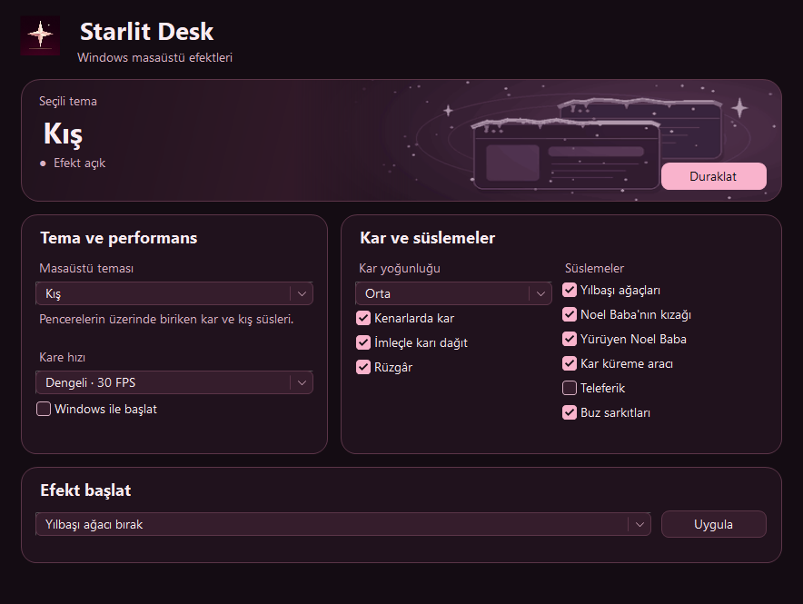

<div align="center">
  
  <h1>Starlit Desk</h1>
  <p><strong>Seasonal effects for your Windows desktop. Start with snow that settles on your windows.</strong></p>
  <p><strong>Language:</strong> <a href="README.md">EN</a> | <a href="README.tr.md">TR</a> · <a href="#quick-start">Quick start</a> · <a href="#build-from-source">Build</a></p>
  <p>
    
    
    
  </p>
</div>

## Windows interface

<p align="center"></p>

The Turkish control panel uses the burgundy and rose palette of AI Usage Hub. The theme selector shows the bundled desktop effects. **Kış** (Winter) is the first theme.

## Quick start

1. Build the app on Windows 10 or 11 with .NET Framework 4.8 or later, then open **StarlitDesk.exe** in the `build` folder. Close older SnowDesk instances before launching.
2. Use the control panel to choose a desktop theme, change the density and frame rate, or trigger an effect. Changes are saved locally.
3. Click the star beside the clock to reopen the panel. Windows may place the star under **^**. Right-click for quick settings, pause or **Çıkış** (Quit).
4. Enable **Windows ile başlat** to start in the tray when you sign in. Turn it off before moving the executable.

## Features

| Area | Behavior |
| --- | --- |
| **Winter** | Snow settles on window edges and at the bottom of each screen. Moving windows can dislodge the snow. |
| **Interaction** | Sweep the pointer to scatter flakes and settled snow. Drag and release a tree to drop or toss it. |
| **Decorations** | Toggle icicles, trees, Santa, the sleigh, the snowplow and the gondola. Launch them on demand, send a gust or clear the trees. |
| **Performance** | Choose 20, 30 or 60 FPS. Pausing stops the frame timer and releases the shared render surface. |
| **Tray** | Close the panel to keep the current effect running. Choose **Çıkış** to exit. |
| **Privacy** | The app runs offline and places effects using window geometry from Windows APIs. |

Starlit Desk keeps existing preferences in `%LOCALAPPDATA%\SnowDeskWindows\settings.ini`.

## Build from source

```powershell
git clone https://github.com/wiski-i/Starlit-Desk.git
cd Starlit-Desk
.\build.ps1
.\build\StarlitDesk.exe
```

The build uses the 64-bit C# compiler included with .NET Framework on Windows. The logo is embedded in the executable for the panel, title bar and notification area.

## Adding a desktop theme

Create a `DesktopScene` implementation and give it a catalog entry in [src/DesktopTheme.cs](src/DesktopTheme.cs). Each entry uses a stable ID, a display name, a description and a factory that creates one scene per monitor. Include the entry in `DesktopTheme.All` to show it in the selector. Keep the ID stable to preserve saved selections. Missing or older theme selections resolve to Winter.

To add an animated preview, place a GIF in [`branding/previews/`](branding/previews/) and set the entry’s preview resource to `StarlitDesk.Previews.<file>.gif`. The preview plays in the selected theme card. Pausing the effect or turning off Windows animation effects pauses the GIF.

| Path | Purpose |
| --- | --- |
| [src/DeskWindow.cs](src/DeskWindow.cs) | Control panel and settings |
| [src/DeskStyle.cs](src/DeskStyle.cs) | Burgundy palette and themed controls |
| [src/SnowField.cs](src/SnowField.cs) | Winter scene and snow simulation |
| [branding/](branding/) | PNG logo and multi-size Windows icon |

## Credits

The Windows snowfall implementation started in this repository as SnowDesk for Windows. DADA Creative's *Snowdesk 1.3* and its bundled guide were the original behavior reference.
