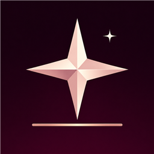
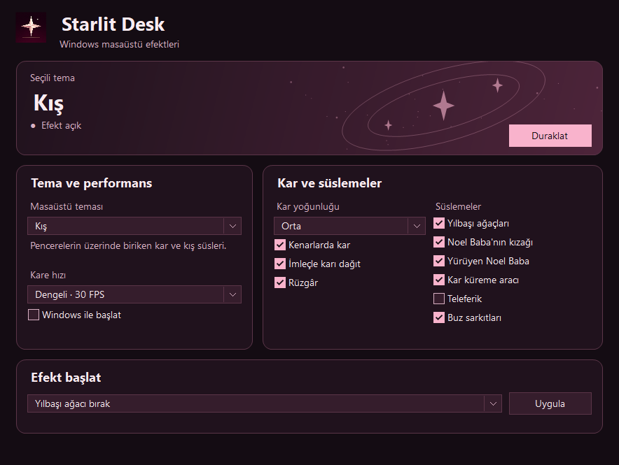

<div align="center">
  
  <h1>Starlit Desk</h1>
  <p><strong>Windows masaüstü için mevsimlik efektler. İlk tema, pencere kenarlarında biriken kar.</strong></p>
  <p><strong>Dil:</strong> <a href="README.md">EN</a> | <a href="README.tr.md">TR</a> · <a href="#hızlı-başlangıç">Hızlı başlangıç</a> · <a href="#kaynaktan-derleme">Derleme</a></p>
  <p>
    
    
    
  </p>
</div>

## Windows arayüzü

<p align="center"></p>

Türkçe kontrol paneli AI Usage Hub’ın yıldızsal bordo ve gül pembesi renklerini kullanır. Tema seçicisinde uygulamaya eklenen masaüstü efektleri görünür. **Kış** ilk temadır.

## Hızlı başlangıç

1. Windows 10 veya 11’de .NET Framework 4.8 veya üzeriyle uygulamayı derle. Eski SnowDesk açıksa kapat, ardından `build` klasöründeki **StarlitDesk.exe** dosyasını çalıştır.
2. Kontrol panelinden masaüstü temasını seç, kar yoğunluğunu ve kare hızını ayarla veya bir efekt başlat. Seçimlerin yerel olarak kaydedilir.
3. Paneli yeniden açmak için Windows saatinin yanındaki yıldız simgesine tıkla. Simge **^** menüsünde de olabilir. Sağ tıkla hızlı ayarlara, **Duraklat** ve **Çıkış** seçeneklerine ulaş.
4. Oturum açtığında tepside başlaması için **Windows ile başlat** seçeneğini aç. Uygulamayı başka klasöre taşımadan önce bu seçeneği kapat.

## Özellikler

| Alan | Davranış |
| --- | --- |
| **Kış** | Kar, pencere kenarlarında ve her ekranın altında birikir. Pencereyi sürükleyince üzerindeki kar dökülebilir. |
| **Etkileşim** | İmleci hızlıca sürükleyerek taneleri ve biriken karı dağıt. Ağacı tutup bırakarak düşür veya fırlat. |
| **Süslemeler** | Buz sarkıtı, ağaç, Noel Baba, kızak, kar küreme aracı ve teleferik seçeneklerini açıp kapat. İstediğinde bir efekt başlat, rüzgâr estir veya ağaçları temizle. |
| **Performans** | 20, 30 veya 60 FPS seç. Duraklatınca kare zamanlayıcısı durur ve ortak çizim yüzeyi serbest bırakılır. |
| **Sistem tepsisi** | Paneli kapatsan da efekt sürer. Uygulamayı kapatmak için **Çıkış**’ı seç. |
| **Gizlilik** | Uygulama çevrimdışı çalışır ve efektleri Windows API’lerinden okuduğu pencere sınırlarına göre yerleştirir. |

Mevcut ayarlar `%LOCALAPPDATA%\SnowDeskWindows\settings.ini` yolunda korunur.

## Kaynaktan derleme

```powershell
git clone https://github.com/wiski-i/Starlit-Desk.git
cd Starlit-Desk
.\build.ps1
.\build\StarlitDesk.exe
```

Derleme, Windows’taki .NET Framework’ün 64 bit C# derleyicisini kullanır. Panel, pencere başlığı ve sistem tepsisi için logo çalıştırılabilir dosyaya gömülür.

## Yeni masaüstü teması ekleme

`DesktopScene` arayüzünü uygulayan bir sınıf yaz ve [src/DesktopTheme.cs](src/DesktopTheme.cs) içindeki kataloğa kaydet. Her tema sabit bir kimlik, görünen ad, açıklama ve her ekran için ayrı efekt örneği üreten bir işlev kullanır. Temayı `DesktopTheme.All` listesine eklediğinde seçicide görünür. Kayıtlı teması bulunamayan veya eski ayar dosyası kullanan kurulumlar **Kış** temasıyla açılır.

| Yol | İçerik |
| --- | --- |
| [src/DeskWindow.cs](src/DeskWindow.cs) | Kontrol paneli ve ayarlar |
| [src/DeskStyle.cs](src/DeskStyle.cs) | Bordo palet ve arayüz kontrolleri |
| [src/SnowField.cs](src/SnowField.cs) | Kış teması ve kar simülasyonu |
| [branding/](branding/) | PNG logo ve çok boyutlu Windows simgesi |

## Kaynak

Windows kar efekti bu depoya SnowDesk for Windows adıyla girdi. DADA Creative’in *Snowdesk 1.3* uygulaması ve kılavuzu ilk davranış referansıydı.
